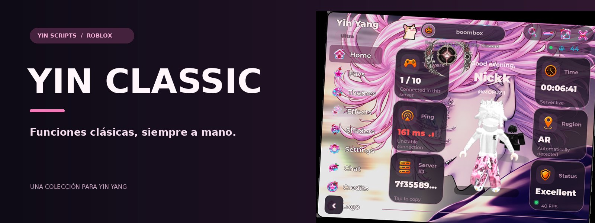

# Yin Classic ✨

**Una colección de funciones clásicas para Yin Yang.**  
Opciones prácticas reunidas en una pestaña.

[Funciones](#funciones) · [Cómo funciona](#cómo-funciona) · [Archivos](#archivos) · [Yin UI](https://github.com/YinScripts/Yin-UI)

---

## Funciones

El catálogo actual reúne cuatro opciones para la pestaña Classic:

| Opción | Descripción |
| :--- | :--- |
| **Ocultar GUIs** | Oculta y restaura las interfaces del jugador. |
| **Ajustar FOV** | Permite ajustar el campo de visión. |
| **Waypoint** | Una herramienta de puntos de referencia. |
| **Optimizar rendimiento** | Reúne ajustes de rendimiento. |

## Cómo funciona

Yin UI consulta el `Manifest` para conocer las opciones disponibles. Cada entrada identifica su nombre en español e inglés y la clave de la función; la pestaña Classic crea los controles correspondientes y carga el script externo cuando se activa una opción.

La portada muestra Yin Yang como ejemplo visual del proyecto; no es una captura de la pestaña Classic.

## Archivos

- [Manifest](Manifest): nombres y claves de las opciones.
- [Yin-Classic](Yin-Classic): implementación de las funciones.
- [Yin UI](https://github.com/YinScripts/Yin-UI): librería que integra la pestaña Classic.

Este repositorio complementa Yin Yang y está pensado para utilizarse desde su interfaz.

---

Una parte del universo <b>YinScripts</b> ✨

